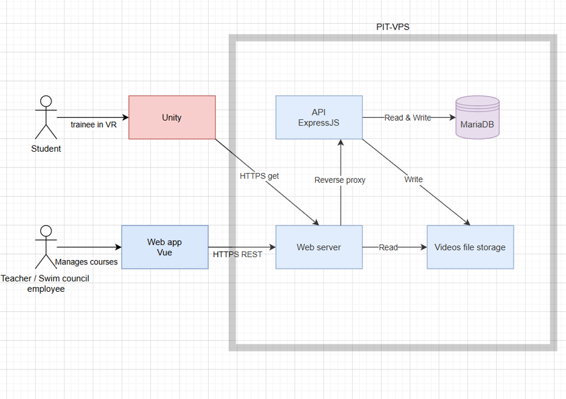

# Deployment van het LifeGuard VR CMS op de VPS van Yonder

## In het kort

Het LifeGuard VR CMS (repository
https://github.com/Team-Education-Futures-Lab/Lifeguard-VR-CMS) bestaat uit een Vue-webapp en een
Express-API. Die worden als twee Docker-images gebouwd en op GitHub Container Registry (GHCR)
gezet. De VPS van Yonder haalt die images op en start ze; er wordt op de VPS niets gebouwd. De
database (MariaDB) staat los van de images: die is op de VPS zelf geïnstalleerd. De bestaande
webserver van de VPS regelt HTTPS en stuurt het verkeer voor `yonder.lifeguardvr.nl` door naar
het CMS.

## Architectuur



- **Web server**: bestaat uit twee lagen. De webserver van de VPS (bestond al, hoort niet bij
  dit project) doet HTTPS en stuurt alles door naar de nginx van het CMS (`web`-container,
  `127.0.0.1:8080`). Die levert de Vue-app, stuurt `/api` door naar de API, levert logo's, en
  levert video's pas nadat de API de toegang heeft gecontroleerd (X-Accel-Redirect).
- **API ExpressJS** (`api`-container): praat met MariaDB en schrijft logo's en video's in mappen
  op de VPS.
- **MariaDB**: op de VPS zelf geïnstalleerd, buiten Docker.
- **Unity**: de VR-app heeft nog geen endpoints in de API (zie open punten).

## Besluiten en waarom

Afgesproken met Geert-jan in november 2026.

| Besluit | Waarom |
| --- | --- |
| Images op GHCR, de VPS haalt ze op | Er wordt één keer gebouwd en getest; de VPS heeft geen code nodig en draait precies wat getest is. |
| De database zit niet in een image | Data hoort niet in een image; MariaDB is al op de VPS geïnstalleerd. |
| Twee images (api en web) achter één poort | Zo werkte het al; één image met nginx en Node samen is meer werk zonder voordeel. Voor de VPS is het één ingang. |
| Een eigen nginx in het CMS, achter de webserver van de VPS | De regels van het CMS (video-beveiliging, uploadlimieten, de Vue-app) blijven in het project; de webserver van de VPS hoeft alleen door te sturen. |
| HTTPS doet de webserver van de VPS | Daar staat het certificaat al. De nginx van het CMS doet daarom gewone http (`nginx/default.prod.conf`). |
| Poort alleen op 127.0.0.1 | Niemand van buiten kan om de webserver van de VPS heen. |
| Logo's en video's in gewone mappen op de VPS | Geert-jan kiest de plek (bijvoorbeeld een aparte schijf) en ze zijn makkelijk te back-uppen. |
| Migraties met de hand | Je ziet wat er met de database gebeurt en kunt eerst een back-up maken. |
| Elke merge naar `main` wordt automatisch een nieuwe versie (`vA.B.C`) op GHCR | `main` is altijd de stabiele stand. CI bouwt en pusht pas als alle tests slagen; de tag bepaalt welke images de VPS gebruikt. |
| Versienummer: patch automatisch, `#minor`/`#major` in de PR-titel | Een computer weet niet of iets een bugfix of een nieuwe functie is; zo hoeft dat alleen bij een grotere update één woord te kosten. |

## Wat er in de repository voor is gemaakt

| Bestand | Wat het doet |
| --- | --- |
| `nginx/default.prod.conf` | nginx-config voor de VPS: gewone http op poort 80, geen certificaat en geen doorsturen naar https. Verder gelijk aan `nginx/default.conf` (lokaal, met HTTPS). |
| `frontend/Dockerfile` | Build-argument `NGINX_CONF` kiest welke config in de web-image gaat. Standaard `default.conf`. |
| `docker-compose.prod.yml` | Draait de images van GHCR op de VPS. Bouwt niets, bevat geen database. |
| `.env.prod.example` | Opzetje voor de instellingen op de VPS, met uitleg per regel. |
| `.dockerignore` | Houdt snapshots, testinloggegevens en testresultaten buiten de build. |
| `.github/workflows/ci.yml` | Job **Release**: na een geslaagde run op `main` een nieuwe versie-tag en beide images op GHCR (zie `docs/ci.md`). |

## Een release maken

Automatisch. Elke merge naar `main` waarbij alle CI-jobs slagen, wordt een nieuwe versie: de job
**Release** in `.github/workflows/ci.yml` bepaalt het nummer, bouwt beide images, zet ze op GHCR
(met het nummer en als `latest`) en zet de git-tag. Het nummer is de vorige versie plus één:

| In de titel van de PR (of de eerste regel van een commit) sinds de vorige versie | Voorbeeld |
| --- | --- |
| niets (bugfix of kleine wijziging) | `v1.0.0` → `v1.0.1` |
| `#minor` (nieuwe functie) | `v1.0.1` → `v1.1.0` |
| `#major` (grote of brekende wijziging) | `v1.1.0` → `v2.0.0` |

Het nieuwe nummer staat na de run in de samenvatting van de run op GitHub (tabblad **Actions**) en
bij **Tags** in de repository. Uitleg en de eenmalige instellingen op GitHub: `docs/ci.md`,
"Releases".

Met de hand (alleen als CI niet beschikbaar is; zo is v1.0.0 gemaakt), op een bijgewerkte `main`:

```bash
R=ghcr.io/team-education-futures-lab; V=<versie, bijv. 1.0.2>
SRC=https://github.com/Team-Education-Futures-Lab/Lifeguard-VR-CMS
L="--label org.opencontainers.image.source=$SRC --label org.opencontainers.image.version=$V"
docker build $L --target prod -t $R/lifeguard-cms-api:$V backend
docker build $L -f frontend/Dockerfile --build-arg NGINX_CONF=default.prod.conf -t $R/lifeguard-cms-web:$V .
docker login ghcr.io -u <github-gebruikersnaam>     # wachtwoord = PAT met write:packages
docker push $R/lifeguard-cms-api:$V
docker push $R/lifeguard-cms-web:$V
git tag -a v$V -m "v$V" && git push origin v$V
```

Het label `org.opencontainers.image.source` koppelt de packages op GitHub aan de repository.
De packages zijn privé: wie ze wil ophalen, moet inloggen.

## Draaiboek: eerste installatie op de VPS

Alle blokken zijn bedoeld om in deze volgorde te kopiëren en te plakken. Tekst tussen `< >` vul
je zelf in. Werk je niet als root en zit je niet in de groep `docker`, zet dan `sudo` voor elk
`docker`-commando, ook voor `docker login`.
Voor stap 6 is een GitHub-token nodig met alleen `read:packages`, zodat de VPS de images mag
ophalen maar niets kan uploaden.

### 1. Controleren wat er op de VPS staat

```bash
docker --version
docker compose version
mariadb --version
```

Verwacht: Docker met Compose v2, en MariaDB 10.11 of nieuwer (het CMS is gebouwd en getest met
11.8).

### 2. Mappen aanmaken

```bash
sudo mkdir -p /opt/lifeguard-cms /srv/lifeguard/uploads /srv/lifeguard/videos
sudo chown "$USER" /opt/lifeguard-cms
```

- `/opt/lifeguard-cms`: hier komen `docker-compose.prod.yml` en `.env`.
- `/srv/lifeguard/uploads` en `/srv/lifeguard/videos`: logo's en video's. Kiest Geert-jan een
  andere plek (bijvoorbeeld een aparte schijf voor video's), pas dan de paden hier en in stap 4 aan.

### 3. Het compose-bestand op de VPS zetten

Op de laptop, in de map van de repository (op `main`, versie v1.0.0):

```bash
scp docker-compose.prod.yml <gebruiker>@<vps-adres>:/opt/lifeguard-cms/
```

### 4. Database, MariaDB-gebruiker en `.env` in één keer

Op de VPS. Dit blok maakt een willekeurig databasewachtwoord, maakt de database en de
MariaDB-gebruiker `cms` aan, en schrijft meteen de `.env`. Het wachtwoord staat daarna alleen in
`/opt/lifeguard-cms/.env`.

```bash
cd /opt/lifeguard-cms
DB_PASS=$(openssl rand -hex 24)

sudo mariadb <<SQL
CREATE DATABASE cms CHARACTER SET utf8mb4;
CREATE USER 'cms'@'172.%' IDENTIFIED BY '$DB_PASS';
GRANT ALL PRIVILEGES ON cms.* TO 'cms'@'172.%';
SQL

cat > .env <<ENV
CMS_IMAGE_PREFIX=ghcr.io/team-education-futures-lab
CMS_VERSION=1.0.0
CMS_HTTP_PORT=8080
CMS_UPLOADS_PATH=/srv/lifeguard/uploads
CMS_VIDEOS_PATH=/srv/lifeguard/videos
DB_HOST=host.docker.internal
DB_PORT=3306
DB_NAME=cms
DB_USER=cms
DB_PASSWORD=$DB_PASS
API_PORT=3000
COOKIE_SECURE=true
ENV
chmod 600 .env
unset DB_PASS
cat .env | grep -v PASSWORD
```

`'cms'@'172.%'` betekent: de gebruiker mag verbinden vanuit Docker-containers (die krijgen een
`172.`-adres). Alle optionele instellingen uit `.env.prod.example` staan hier niet in; dan gelden
de standaardwaarden.

### 5. MariaDB bereikbaar maken vanuit Docker

De containers verbinden met MariaDB via het Docker-adres van de VPS (meestal `172.17.0.1`).
Standaard luistert MariaDB alleen op `127.0.0.1`. Controleer eerst:

```bash
ip -4 addr show docker0 | grep inet
sudo grep -Rn "bind-address" /etc/mysql/
```

Staat `bind-address` op `127.0.0.1`, dan moet MariaDB ook op het Docker-adres luisteren.
**Overleg dit met Geert-jan**, want andere projecten kunnen dezelfde MariaDB gebruiken. Een
voorstel dat MariaDB niet op internet openzet: in het bestand dat `grep` vond,

```ini
bind-address = 127.0.0.1,172.17.0.1
```

(gebruik het adres uit `ip addr`) en daarna:

```bash
sudo systemctl restart mariadb
```

Gebruikt de VPS een firewall (`ufw`), dan moet verkeer van Docker naar poort 3306 zijn toegestaan.

### 6. Inloggen bij GHCR en starten

```bash
cd /opt/lifeguard-cms
docker login ghcr.io -u <github-gebruikersnaam>      # wachtwoord = een GitHub-token met alleen read:packages
docker compose -f docker-compose.prod.yml pull
docker compose -f docker-compose.prod.yml up -d
docker compose -f docker-compose.prod.yml logs --tail=20 api
```

In de logs moet staan:

- `API listening on port 3000`
- `session cleanup: removed 0 expired sessions` → de API kan de database bereiken.

Staat er `session cleanup failed`, dan lukt de verbinding met MariaDB niet: zie
"Problemen oplossen".

### 7. Tabellen en de eerste beheerder aanmaken

```bash
cd /opt/lifeguard-cms
docker compose -f docker-compose.prod.yml exec api npx knex migrate:latest
docker compose -f docker-compose.prod.yml exec api node scripts/create-admin.js beheer
```

Verwacht na de migraties: `Batch 1 run: 12 migrations`. Bij `create-admin` typ je twee keer
het wachtwoord van de **beheerder** (minimaal 10 tekens; je ziet niets tijdens het typen). Dat is
het account voor `https://yonder.lifeguardvr.nl/admin/login`, niet de MariaDB-gebruiker.

Controle op de VPS zelf:

```bash
curl -s http://127.0.0.1:8080/api/auth/me
```

Verwacht: `{"error":{"code":"not_authenticated",...}}`. Dat betekent: nginx en de API werken.

### 8. De webserver van de VPS koppelen

Door Geert-jan, in de bestaande configuratie voor `yonder.lifeguardvr.nl`. Voorbeeld voor nginx;
de regels met het certificaat bestaan al.

```nginx
server {
    listen 443 ssl;
    server_name yonder.lifeguardvr.nl;
    # ssl_certificate en ssl_certificate_key: zoals ze al staan

    # Alleen voor deze site:
    client_max_body_size 40m;            # video's gaan in stukken van 32 MB, logo's tot 2 MB
    large_client_header_buffers 4 32k;   # uploadgegevens in een header tot ~13 KB

    location / {
        proxy_pass http://127.0.0.1:8080;
        proxy_set_header Host $host;
        proxy_set_header X-Forwarded-For $proxy_add_x_forwarded_for;
        proxy_set_header X-Forwarded-Proto $scheme;
        proxy_http_version 1.1;
        proxy_request_buffering off;     # uploads direct doorsturen
        proxy_send_timeout 300s;         # het laatste stuk van een video wacht op de controle
        proxy_read_timeout 300s;
    }
}
```

```bash
sudo nginx -t && sudo systemctl reload nginx
```

Let op: nginx neemt `large_client_header_buffers` soms over van de standaardsite op dezelfde
poort. Lukt een video-upload met een lange beschrijving niet (fout 400 of 494), dan moet die regel
ook in de standaardsite staan.

### 9. Controleren van buitenaf

- [ ] `https://yonder.lifeguardvr.nl/admin/login` opent zonder certificaatwaarschuwing.
- [ ] Inloggen als beheerder lukt; een organisatie aanmaken lukt.
- [ ] Inloggen als die organisatie lukt; een logo uploaden lukt en het logo is te zien.
- [ ] Een video uploaden lukt en de thumbnail verschijnt.

## Een nieuwe versie uitrollen

Na een nieuwe release (zie "Een release maken"; het nummer staat op GitHub bij **Tags**), bijvoorbeeld v1.0.1:

```bash
cd /opt/lifeguard-cms
sed -i 's/^CMS_VERSION=.*/CMS_VERSION=1.0.1/' .env
docker compose -f docker-compose.prod.yml pull
docker compose -f docker-compose.prod.yml up -d
docker compose -f docker-compose.prod.yml exec api npx knex migrate:latest
```

De migraties voeren alleen nieuwe stappen uit. Database, logo's en video's staan buiten de
containers en blijven bewaard. Terug naar de vorige versie: zet `CMS_VERSION` terug en voer
`pull` en `up -d` uit (alleen veilig als de nieuwe versie geen migraties had).

## Problemen oplossen

| Wat je ziet | Waarschijnlijke oorzaak |
| --- | --- |
| `session cleanup failed` of `ECONNREFUSED` in de API-logs | MariaDB luistert niet op het Docker-adres (stap 5) of een firewall blokkeert poort 3306. |
| `Access denied for user 'cms'@'172.…'` | De MariaDB-gebruiker is niet voor `'172.%'` aangemaakt, of het wachtwoord in `.env` klopt niet. |
| `required variable … is missing a value` bij `docker compose` | Een verplichte regel in `.env` is leeg. |
| `denied` of `unauthorized` bij `pull` | Niet ingelogd bij GHCR, of het token mist `read:packages` of SSO-autorisatie. |
| 502 Bad Gateway op de site | De containers draaien niet (`docker compose -f docker-compose.prod.yml ps`) of de poort in de webserver klopt niet met `CMS_HTTP_PORT`. |
| 413 Request Entity Too Large bij uploaden | `client_max_body_size` in de webserver van de VPS is te klein (stap 8). |
| Video-upload stopt aan het eind | `proxy_read_timeout` of `proxy_send_timeout` in de webserver van de VPS is te kort (stap 8). |
| Steeds opnieuw naar het inlogscherm | De site wordt over http in plaats van https geopend; de inlogcookie werkt alleen via https. |

## Open punten

| Punt | Stand |
| --- | --- |
| Back-ups van de database en de mappen met logo's en video's | Nog niet besproken. Zonder back-up zijn bij een defecte schijf alle cursussen en video's weg. |
| Automatisch uitrollen op de VPS na een release (via SSH vanuit CI) | Nog niet gebouwd: na een release zet iemand op de VPS `CMS_VERSION` en voert `pull` en `up -d` uit. |
| Limieten in de webserver van de VPS alleen voor deze site | Navragen bij Geert-jan (stap 8). |
| Verbindingen voor de Unity-app (Quest) | De API heeft nog geen endpoints voor de VR-app; staat los van deze installatie. |
